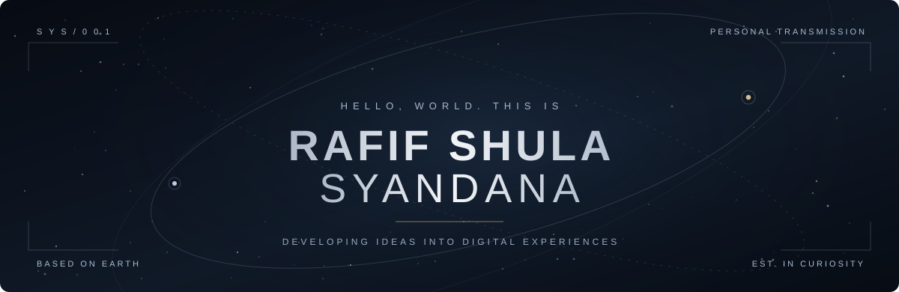
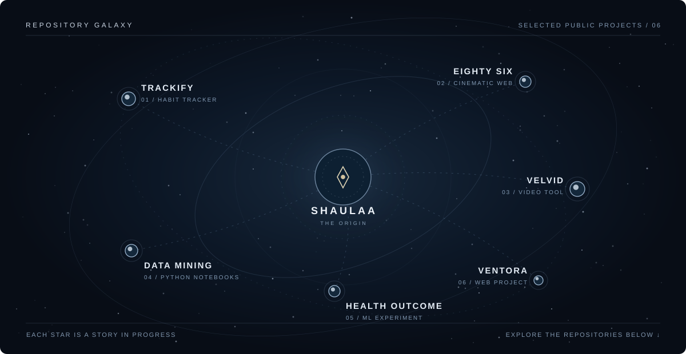

<!--
  SH AULA A / REPOSITORY GALAXY
  Free, original GitHub profile README.
  Place both SVG files inside the assets/ directory.
-->

<div align="center">
  

  <br />

  <a href="https://www.syandana.my.id/">PORTFOLIO</a>
  &nbsp;&nbsp; · &nbsp;&nbsp;
  <a href="https://github.com/Shaulaa?tab=repositories">REPOSITORIES</a>
  &nbsp;&nbsp; · &nbsp;&nbsp;
  <a href="https://github.com/Shaulaa">GITHUB</a>

  <br /><br />
  <sub>Informatics student · Web development · Machine learning · Creative coding</sub>
</div>

<br />

### `01 / ABOUT THE EXPLORER`

Hey, I'm **Rafif Shula Syandana**, an Informatics student exploring the space between **software engineering and visual storytelling**. I enjoy building practical web applications and experimenting with interfaces that feel a little different.

Currently exploring **Laravel**, **JavaScript**, **Python**, and the little details that make the web memorable.

<br />

### `02 / THE REPOSITORY GALAXY`

<div align="center">
  <a href="https://github.com/Shaulaa?tab=repositories">
    
  </a>
  <br />
  <sub>A visual map of selected public repositories. Select a project below to explore its source.</sub>
</div>

<br />

| SIGNAL | PROJECT | FIELD NOTES |
| :--- | :--- | :--- |
| `01` | [**Trackify**](https://github.com/Shaulaa/trackify-daily-tracker) | A habit tracker inspired by *Atomic Habits*. |
| `02` | [**Eighty Six**](https://github.com/Shaulaa/eighty-six) | A cinematic fan-made website inspired by the anime *86 Eighty-Six*. |
| `03` | [**Velvid**](https://github.com/Shaulaa/velvid) | A local web-based video downloader using Node.js, Express, yt-dlp, and FFmpeg. |
| `04` | [**Data Mining**](https://github.com/Shaulaa/data-mining) | Python notebooks covering similarity, classification, and ensemble methods. |
| `05` | [**Health Outcome Prediction**](https://github.com/Shaulaa/health-outcome-prediction.ipynb) | A machine learning experiment using decision trees to predict diabetes risk. |
| `06` | [**Ventora**](https://github.com/Shaulaa/ventora-coffe) | Another project in the collection. |

<br />

### `03 / TOOLKIT`

```text
WEB         HTML · CSS · JavaScript · PHP · Laravel
DATA        Python · Jupyter Notebook · Machine Learning
INTERESTS   Interface Design · Creative Coding · Web Experiences
```

<br />

### `04 / OPEN CHANNEL`

<div align="center">
  <p><i>Somewhere between code and cosmos, there is always something new to build.</i></p>
  <p>
    <a href="https://www.syandana.my.id/"><b>ENTER THE PORTFOLIO ↗</b></a>
    &nbsp;&nbsp;&nbsp;&nbsp;
    <a href="https://github.com/Shaulaa?tab=repositories"><b>EXPLORE ALL PROJECTS ↗</b></a>
  </p>
  <sub>Designed to stay minimal. Built to keep evolving.</sub>
</div>
